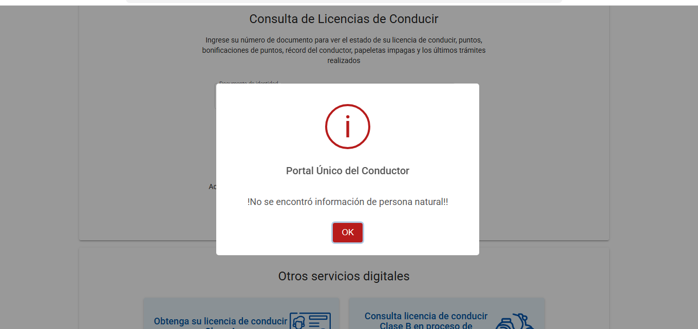

# Auditoría pasiva de seguridad — licencias.mtc.gob.pe

**Fecha:** 24 de octubre de 2026  
**Objetivo revisado:** `https://licencias.mtc.gob.pe/#/index` y flujo `#/search`  
**Tipo de revisión:** análisis pasivo y no intrusivo del HTML, cabeceras HTTP y JavaScript público.

## Resumen ejecutivo

Se identificó un hallazgo de severidad alta en el diseño observable del captcha, tres hallazgos medios de defensa y privacidad, y dos áreas que requieren validación activa autorizada. No se explotó el servicio, no se omitió el captcha, no se consultaron documentos reales y no se realizó enumeración, fuerza bruta ni fuzzing.

El principal riesgo es que el desafío visual y la decisión de acierto ocurren completamente en JavaScript del navegador. Tras el acierto, el cliente genera un UUID aleatorio y lo entrega a `RegisterToken`; el servidor no recibe la imagen elegida ni una prueba criptográfica vinculada al desafío observable. Esto reduce considerablemente la capacidad del captcha para impedir automatización. La confirmación definitiva de aceptación de UUID arbitrarios requeriría una prueba activa con autorización del MTC, que no se realizó.

## Alcance y evidencia

- HTML y cabeceras obtenidos mediante una única solicitud normal de navegador.
- Bundle oficial observado: `main.f392ef2ab011cb01.js`.
- Copia usada para análisis local: `output/playwright/reference-main.js`.
- Respuestas previamente observadas:
  - `GET RegisterToken`: HTTP 405.
  - `POST RegisterToken` con cuerpo vacío: HTTP 200, `IsSuccess: false`, error de captcha.
  - Protección de tasa: HTTP 429 / Cloudflare 1015 después de solicitudes repetidas.

## Hallazgos confirmados

### MTC-01 — Confianza excesiva en captcha ejecutado en el cliente

- **Severidad:** Alta
- **Componente:** captcha visual → `RegisterToken`.
- **Evidencia del bundle:**
  - Las ocho imágenes, la consigna y la imagen correcta se seleccionan localmente.
  - `seleccionarImagen(e)` compara en el cliente `e === imagenCorrecta.nombre`.
  - En caso correcto se ejecuta `uuidv4Local()` y se emite ese UUID.
  - El popup envía `new Pw(0, "", tokenResponse, "")` a `RegisterToken`.
- **Impacto:** un cliente modificado podría omitir la interacción visual y automatizar la obtención de tokens, facilitando consultas masivas o enumeración de documentos personales.
- **Certeza:** alta respecto al diseño cliente; no se confirmó activamente si el servidor acepta cualquier UUID válido.
- **Corrección recomendada:** generar el desafío en el servidor, asociarlo a un nonce de sesión, guardar la solución exclusivamente en servidor y emitir un comprobante firmado, de un solo uso y corta duración solo después de validar la selección.
- **Controles complementarios:** límite por IP/sesión/documento, espera progresiva, detección de automatización y alertas por volumen.

### MTC-02 — Ausencia observable de cabeceras defensivas

- **Severidad:** Media
- **Componente:** respuesta HTML principal.
- **Evidencia:** la respuesta HTTP 200 no incluyó:
  - `Content-Security-Policy`
  - `X-Content-Type-Options`
  - `X-Frame-Options`
  - `Referrer-Policy`
  - `Permissions-Policy`
  - `Strict-Transport-Security`
  - `Cross-Origin-Opener-Policy`
- **Impacto:** menor protección en profundidad frente a XSS, clickjacking, interpretación incorrecta de contenido, filtración de referentes y abuso de capacidades del navegador.
- **Corrección recomendada:** desplegar una CSP probada en modo report-only y luego aplicar como mínimo `default-src 'self'`, política estricta para scripts, `object-src 'none'`, `base-uri 'self'` y `frame-ancestors 'none'` o la lista institucional requerida. Añadir `nosniff`, política de referente y permisos mínimos.
- **Nota:** Cloudflare puede gestionar algunas cabeceras en otra capa; no aparecieron en la respuesta observada.

### MTC-03 — Bearer temporal almacenado en `sessionStorage`

- **Severidad:** Media
- **Componente:** autenticación de invitado.
- **Evidencia del bundle:** `sessionStorage.setItem("portalUnicoToken", t.Token)` y nueve lecturas posteriores de `portalUnicoToken`.
- **Impacto:** cualquier XSS ejecutado en el mismo origen podría leer y exfiltrar el Bearer durante la sesión. La ausencia de CSP aumenta el impacto potencial.
- **Corrección recomendada:** preferir una cookie de sesión `HttpOnly`, `Secure`, `SameSite=Strict` administrada por el servidor o mantener el token solo en memoria JS con vida muy corta y rotación. Una cookie requiere protección CSRF apropiada.
- **Mitigación:** CSP estricta, expiración mínima, token de un solo propósito y revocación tras uso.

### MTC-04 — Compartición de datos personales con terceros

- **Severidad:** Media
- **Componente:** botones Facebook, X/Twitter, LinkedIn, WhatsApp y Telegram.
- **Evidencia del bundle:** las URLs de WhatsApp y Telegram incorporan apellidos, nombres, número de licencia y categoría antes de abrir el servicio externo.
- **Impacto:** los datos salen del dominio institucional y quedan sujetos al tratamiento de plataformas externas; el usuario puede no advertir exactamente qué información se enviará.
- **Corrección recomendada:** mostrar una confirmación explícita con vista previa de los datos, compartir por defecto solo un enlace opaco sin PII y documentar los terceros en la política de privacidad.
- **Mitigación:** codificar parámetros con `URLSearchParams`/`encodeURIComponent` y abrir con `noopener,noreferrer`.

### MTC-05 — Apertura de ventanas externas sin aislamiento observable

- **Severidad:** Baja
- **Componente:** funciones sociales.
- **Evidencia del bundle:** varias llamadas `window.open(url, "_blank")` sin tercer argumento `noopener,noreferrer` ni anulación explícita de `opener`.
- **Impacto:** una página externa podría intentar interactuar con `window.opener`; navegadores modernos mitigan parte del riesgo, pero no debe dependerse de comportamiento implícito.
- **Corrección recomendada:** `window.open(url, '_blank', 'noopener,noreferrer')` y establecer `newWindow.opener = null` como compatibilidad adicional.

## Observaciones positivas

- El recurso de Cloudflare Insights incluye `integrity` y `crossorigin="anonymous"`.
- Las llamadas con datos usan HTTPS.
- Los endpoints sensibles observados emplean Bearer en cabecera, no parámetros de URL.
- Cloudflare aplica limitación y devolvió HTTP 429 / código 1015.
- La respuesta de consulta se mantiene principalmente en memoria de Angular, no se observó almacenamiento persistente en `localStorage`.

## Riesgos que requieren autorización para confirmar

### MTC-U01 — Aceptación de UUID de captcha no vinculado

La lectura del cliente indica que el UUID se crea localmente sin intercambio previo con el servidor. Confirmar que `RegisterToken` acepta un UUID arbitrario equivaldría a probar activamente un bypass de captcha. No se realizó.

### MTC-U02 — Autorización por objeto en endpoints de detalle

Endpoints como `detallePapeletaSancion`, `obtenerDetalleSancion` y descargas reciben identificadores de administrado/resolución junto al Bearer de invitado. Debe verificarse internamente que el servidor vincula esos identificadores al documento consultado y no permite modificar referencias para acceder a registros ajenos. No se intentó alterar identificadores.

### MTC-U03 — Manejo de caché de respuestas con PII

La respuesta HTML principal no incluyó `Cache-Control`. Debe verificarse que todas las respuestas JSON/PDF con datos personales envíen `Cache-Control: no-store, private` y que Cloudflare no las almacene.

## Plan de corrección recomendado

1. **Inmediato:** rediseñar el captcha para que desafío, solución, nonce y validación residan en servidor.
2. **Inmediato:** revisar autorización por objeto de endpoints de detalle y descarga mediante pruebas internas.
3. **Corto plazo:** aplicar límites por IP, sesión, token y documento con telemetría de abuso.
4. **Corto plazo:** desplegar CSP y cabeceras defensivas, primero en modo de reporte.
5. **Corto plazo:** retirar PII del texto compartido o solicitar confirmación específica.
6. **Mediano plazo:** sustituir `sessionStorage` por una sesión protegida o reducir al mínimo la vida y alcance del Bearer.
7. **Continuo:** pruebas SAST/DAST autenticadas en ambiente de preproducción y revisión de logs sin DNI/tokens.

## Limitaciones

Esta auditoría no demuestra explotación. Los hallazgos se basan en comportamiento y código cliente públicamente observable. Una auditoría completa requiere autorización escrita, un ambiente de pruebas, rangos de IP permitidos, cuentas/documentos sintéticos, contactos de emergencia y reglas de detención.

## Resultado

**Auditoría pasiva completada.** Prioridad principal: MTC-01. No deben publicarse detalles operativos de bypass ni realizarse pruebas activas contra producción sin coordinación formal con el MTC.
